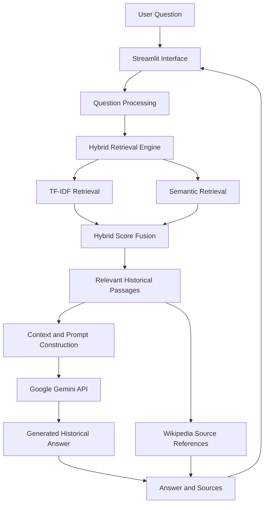

# HistoryGPT – Historical Intelligence Chatbot

<p align="center">
  <strong>An AI-powered, evidence-grounded historical question-answering system</strong>
</p>

<p align="center">
  Explore civilizations, historical personalities, wars, revolutions, discoveries, and forgotten stories through an intelligent conversational interface.
</p>

---

## Overview

**HistoryGPT** is an AI-powered historical question-answering chatbot designed to make historical information easier to explore, understand, and research.

The system combines **Retrieval-Augmented Generation (RAG)**, **hybrid information retrieval**, **Sentence Transformers**, **TF-IDF**, **Wikipedia knowledge sources**, and **Google Gemini** to generate contextual answers supported by retrieved historical passages.

Instead of relying entirely on the language model's internal knowledge, HistoryGPT retrieves relevant historical information from its knowledge base and uses that evidence to construct answers.

The application provides an interactive Streamlit dashboard with historical exploration, quizzes, flashcards, research notes, and analytics.

## Key Features

### 1. AI Historical Question Answering
- Ask questions about historical events, empires, civilizations, and personalities.
- Generate contextual answers using Google Gemini.
- Retrieve relevant historical passages before answer generation.
- Display supporting Wikipedia sources.
- Maintain conversational context within a session.

### 2. Hybrid Retrieval-Augmented Generation

HistoryGPT combines two retrieval techniques:

- **TF-IDF:** Identifies keyword and term-frequency relevance.
- **Semantic Search:** Uses Sentence Transformers to identify contextual similarity.

The initial hybrid scoring strategy is:

\[
S(q,d)=0.35S_{\text{TF-IDF}}(q,d)+0.65S_{\text{Semantic}}(q,d)
\]

Where:

- \(S(q,d)\) represents the combined relevance score.
- \(S_{\text{TF-IDF}}\) represents lexical similarity.
- \(S_{\text{Semantic}}\) represents embedding-based semantic similarity.

The weights are initial heuristic settings and can be tuned through evaluation.

### 3. Historical Knowledge Base
The knowledge base uses Wikipedia articles covering topics such as:

- Ancient Egypt
- Indus Valley Civilization
- Maurya Empire
- Ashoka
- Gupta Empire
- Roman Empire
- Alexander the Great
- World War I
- World War II
- French Revolution
- Industrial Revolution
- Mughal Empire

Historical articles are divided into smaller overlapping text chunks for retrieval.

### 4. Interactive Dashboard

The Streamlit interface includes the following sections:

| Module | Purpose |
|---|---|
| AI Chat | Historical question answering |
| Time Explorer | Explore historical periods and events |
| Knowledge Arena | Historical knowledge quizzes |
| Flashcard Studio | Historical revision and learning |
| Research Notebook | Save research notes |
| Analytics | View session-level activity |

Some learning modules currently use prototype/static content and can be expanded into fully dynamic modules.

### 5. Evidence-Based Responses
- Retrieves relevant passages from the historical knowledge base.
- Provides source titles and Wikipedia links.
- Uses retrieved context to ground generated answers.
- Helps users trace the information used in an answer.

---

## System Architecture

HistoryGPT follows a modular Retrieval-Augmented Generation architecture.



### Architecture Explanation

**1. User Interface Layer**

Streamlit provides the interactive interface through which users submit questions and explore historical learning modules.

**2. Question Processing Layer**

The system receives the question and prepares it for retrieval.

**3. Hybrid Retrieval Layer**

The retrieval engine independently evaluates the question using TF-IDF and semantic embeddings.

**4. Context Selection Layer**

Relevant historical passages are ranked and selected. A diversity filter helps reduce repetitive results.

**5. Prompt Construction Layer**

The retrieved passages are formatted into a context-aware prompt containing instructions to answer using available evidence.

**6. Language Generation Layer**

Google Gemini generates the natural-language response using the supplied context.

**7. Response Layer**

The final answer and supporting source references are displayed in the Streamlit application.

---

## Technology Stack

| Technology | Application |
|---|---|
| Python | Core programming language |
| Streamlit | Interactive web application |
| Google Gemini API | Language generation |
| Sentence Transformers | Semantic embeddings |
| all-MiniLM-L6-v2 | Embedding model |
| Scikit-learn | TF-IDF and similarity calculations |
| NumPy | Numerical computation |
| FAISS | Vector similarity indexing, where used |
| Wikipedia | Historical knowledge source |
| Google Colab | Development and experimentation |
| Google Drive | Project and artifact storage |

---

## Retrieval Methodology

### Step 1: Knowledge Collection

Historical articles are collected from Wikipedia using its available interfaces and stored in JSON format.

Each document contains:

- Article title
- Article URL
- Article content
- Extracted text

### Step 2: Text Chunking

Long historical articles are divided into smaller text chunks.

Initial configuration:

| Parameter | Value |
|---|---:|
| Chunk size | 900 words |
| Chunk overlap | 150 words |
| Minimum chunk length | 50 words |

Overlapping chunks help preserve context between adjacent passages.

### Step 3: TF-IDF Vectorization

TF-IDF converts historical passages into numerical vectors based on the importance of terms.

Initial configuration:

- English stop-word removal
- Unigrams and bigrams
- Maximum 30,000 features

### Step 4: Semantic Embedding

The Sentence Transformer model:

`sentence-transformers/all-MiniLM-L6-v2`

converts historical passages into dense semantic embeddings.

The embeddings are normalized before similarity calculations.

### Step 5: Hybrid Retrieval

The system combines lexical and semantic similarity:

\[
S_{\text{Hybrid}}=0.35S_{\text{TF-IDF}}+0.65S_{\text{Semantic}}
\]

The resulting passages are ranked, and a diversity-aware selection step reduces near-duplicate results.

### Step 6: Context-Grounded Generation

The retrieved passages are inserted into the Gemini prompt.

The language model uses this context to formulate a readable historical answer.

---

## Project Structure

```text
HistoryGPT/
│
├── app.py
├── config.json
├── requirements.txt
├── README.md
│
├── backend/
│
├── database/
│
├── utils/
│
├── assets/
│
├── models/
│   └── retrieval_index.pkl
│
├── data/
│   ├── history_chunks.json
│   ├── history_chunks_v2.json
│   ├── history_chunks_v3.json
│   └── indian_history_wikipedia.json
│
├── vector_database/
│   ├── chunk_metadata.json
│   ├── history_embeddings.npy
│   ├── history_embeddings_v3.npy
│   ├── history_index.faiss
│   └── history_faiss_v3.index
│
├── historical_knowledge.json
└── retrieval_index.pkl
```

*The listed structure reflects the current project artifacts. Some directories may be used for future modular expansion.*

---

## Installation and Setup

### Prerequisites

- Python 3.10 or later
- pip
- Google Gemini API key
- Git
- Internet connection

### 1. Clone the Repository

```bash
git clone https://github.com/Yaseen-2004/Historical-Intelligence-Chart.git

cd Historical-Intelligence-Chart
```

### 2. Create a Virtual Environment

```bash
python -m venv venv
```

Activate it:

**Windows:**

```bash
venv\Scripts\activate
```

**Linux / macOS:**

```bash
source venv/bin/activate
```

### 3. Install Dependencies

```bash
pip install -r requirements.txt
```

### 4. Configure Gemini API

Create a `.env` file in the project root:

```env
GEMINI_API_KEY=your_gemini_api_key
GEMINI_MODEL=gemini-3.8-flash
```

Replace the example key with your own valid API key.

Never upload `.env` or API keys to GitHub.

If the application uses a different model configured in `app.py`, ensure `GEMINI_MODEL` matches that implementation.

### 5. Run the Application

```bash
streamlit run app.py
```

Open the local URL displayed in your terminal, usually:

```text
http://localhost:8501
```

---

## Google Colab Development

The project was developed using Google Colab.

The development workflow includes:

1. Mount Google Drive.
2. Install Python dependencies.
3. Collect historical Wikipedia articles.
4. Clean and process historical content.
5. Generate overlapping text chunks.
6. Build TF-IDF representations.
7. Generate semantic embeddings.
8. Construct the hybrid retrieval index.
9. Save the retrieval artifacts to Google Drive.
10. Integrate Gemini for answer generation.
11. Build and test the Streamlit dashboard.

The retrieval artifacts allow the application to reuse the prepared knowledge base without rebuilding it every time.

---

## Example Questions

Users can explore questions such as:

- Who was Ashoka and what was his contribution to Buddhism?
- What caused the French Revolution?
- What were the major achievements of the Gupta Empire?
- How did the Indus Valley Civilization develop?
- What were the major causes of World War II?
- What was the significance of the Industrial Revolution?
- How did the Roman Empire expand?

---

## Limitations

The current implementation has several limitations:

1. The historical knowledge base covers a selected set of topics rather than all historical periods.
2. Retrieval quality depends on the coverage and quality of collected Wikipedia content.
3. Gemini API availability and request quotas affect answer generation.
4. Generated answers may contain inaccuracies and should be checked against original sources.
5. The current retrieval weights are heuristic and have not yet been comprehensively optimized.
6. Some dashboard modules currently use static demonstration content.
7. Session-level analytics and notes are not yet a complete persistent multi-user system.
8. Wikipedia content licensing and attribution requirements must be respected when redistributing the dataset.

---

## Future Enhancements

Planned improvements include:

- Expanded historical knowledge base.
- More advanced hybrid retrieval and ranking.
- Retrieval evaluation using precision, recall, MRR, and nDCG.
- Source-grounded answer verification.
- Interactive historical timelines.
- Interactive 3D historical globe.
- Dynamic quizzes and flashcards.
- Personalized learning and revision plans.
- Persistent research notebooks.
- User authentication and database integration.
- Multi-language historical question answering.
- Deployment on Streamlit Community Cloud or another hosting platform.

---

## Research and Evaluation Opportunities

The system can be evaluated using:

| Evaluation Area | Possible Metric |
|---|---|
| Retrieval relevance | Precision@K |
| Retrieval coverage | Recall@K |
| Ranking quality | MRR / nDCG |
| Answer correctness | Human evaluation |
| Evidence support | Citation accuracy |
| Performance | Response latency |
| Resource usage | Memory and API consumption |

A formal evaluation should use a curated question-answer benchmark with reference passages and documented scoring procedures.

---

## Responsible Use and Data Attribution

HistoryGPT is an educational and research-oriented project.

- Historical answers should be verified using reliable primary and secondary sources.
- Wikipedia content is subject to its applicable licensing terms, including attribution and share-alike requirements where applicable.
- Individual images and other media may have separate licenses.
- The application should not be treated as a substitute for academic historical research.

Wikipedia: https://www.wikipedia.org/

---

## Author

**Syed Mohammed Yaseen**

B.Tech – Computer Science and Engineering  
Specialization: Artificial Intelligence and Machine Learning  
Presidency University, Bengaluru

**Interests:** Artificial Intelligence, Machine Learning, Generative AI, Natural Language Processing, and Data Science.

### Connect

- GitHub: https://github.com/Yaseen-2004
- LinkedIn: https://www.linkedin.com/in/syed-mohammed-yaseen-589766291/

---

## License

Choose and add an appropriate open-source license before distributing this project. The licensing of the source code does not override the licensing requirements of third-party historical content and media.

---

<p align="center">
  <strong>HistoryGPT — Explore the Past. Understand History.</strong>
</p>
